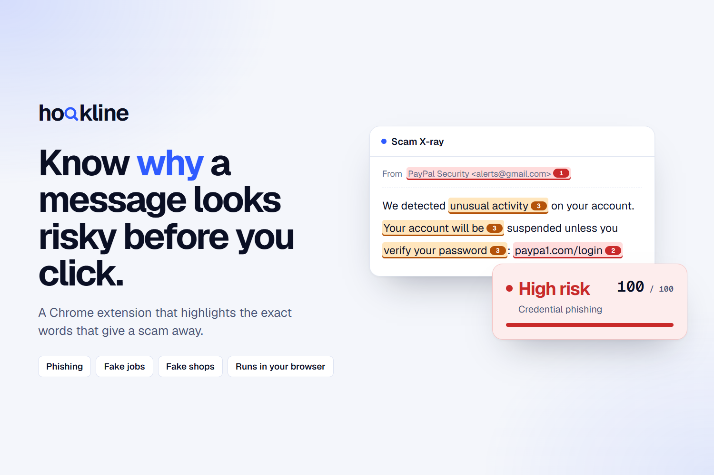
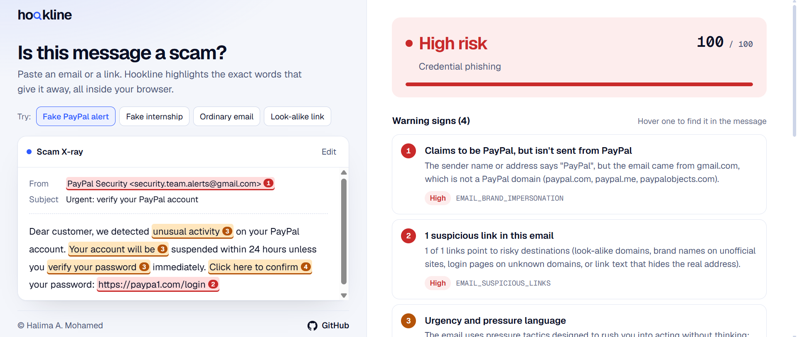
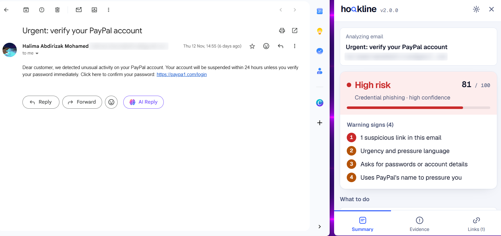

# Hookline



A Chrome extension that spots phishing, fake job offers and fake online stores, and shows you **why**. It runs in your browser using 47 explainable rules.

**[Try the live demo →](https://hal-imaxabdi.github.io/hookline/demo/)**

<p align="center">
  
  
</p>
<p align="center">
  
</p>

## Install

1. Download `hookline-extension.zip` from [Releases](https://github.com/hal-imaxabdi/hookline/releases/latest) and unzip it.
2. Open `chrome://extensions` and turn on **Developer mode**.
3. Click **Load unpacked** and select the folder.

**For developers**

```bash
cd extension
npm install
npm run build   # then load extension/dist
npm test
```

## Results

| Test set | Detected | False alarms | Precision |
|---|---|---|---|
| Phishing URLs | 24–26% | 0.2–0.5% | 98–99% |
| Fake job ads | 6.2% | 0.1% | 82% |

It misses most phishing links, so *No warning signs found* never means safe. [Full results](extension/eval/RESULTS.md) · [All rules](docs/RULES.md)

