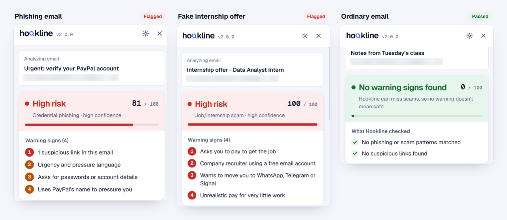

<p align="center">
  
</p>

# Hookline

**Know why a message looks risky before you click.**

Scammers target students and job seekers with fake internships, look-alike login pages and "too good to be true" shops. Most tools either stay silent or block something without saying why. Hookline is a Chrome extension that flags these scams and explains each warning in plain language, so you learn to spot the next one yourself.

**[Try the live demo →](https://hal-imaxabdi.github.io/hookline/demo/)** No install needed.

## What it catches

| Scam | Example warning signs |
|---|---|
| **Phishing** | Look-alike domains (`paypa1.com`), a sender pretending to be a brand, requests for your password |
| **Fake jobs** | Fees to get hired, moving the chat to Telegram or WhatsApp, offers with no interview, "$45/hr, no experience" |
| **Fake shops** | 80–90% discounts, payment only by crypto or gift cards, no contact details, countdown pressure |

## How it explains a result

- **A clear verdict:** *High risk*, *Suspicious* or *No warning signs found*, with the scam type.
- **Numbered warning signs,** each one tied to a documented rule. No black-box AI.
- **What to do next,** written for that kind of scam.
- **Scam X-ray** (in the demo): highlights the exact words that gave the scam away.

**Private by design:** everything runs in your browser. Nothing you read is sent anywhere.

## Install

1. Download `hookline-extension.zip` from [Releases](https://github.com/hal-imaxabdi/hookline/releases/latest) and unzip it.
2. Open `chrome://extensions` and turn on **Developer mode**.
3. Click **Load unpacked** and select the folder. Hookline checks Gmail automatically and adds a side panel for links and pages.

**For developers**

```bash
cd extension
npm install
npm run build   # then load extension/dist
npm test
```

## Results

Tested once on held-out public datasets:

| Test set | Detected | False alarms | Precision |
|---|---|---|---|
| Phishing URLs | 24–26% | 0.2–0.5% | 98–99% |
| Fake job ads | 6.2% | 0.1% | 82% |

When Hookline warns, it is almost always right, but it misses most phishing links, so *No warning signs found* never means safe. [Full results](extension/eval/RESULTS.md) · [All 47 rules](docs/RULES.md)

## Screenshots

<p align="center">
  
  
</p>
<p align="center">
  
</p>

