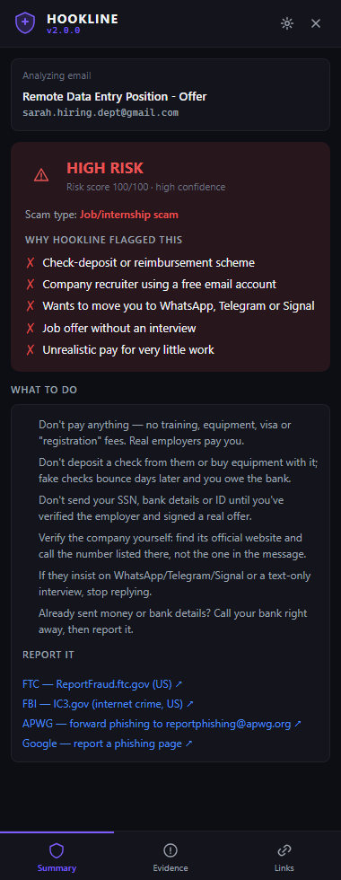
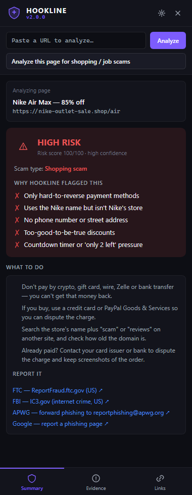
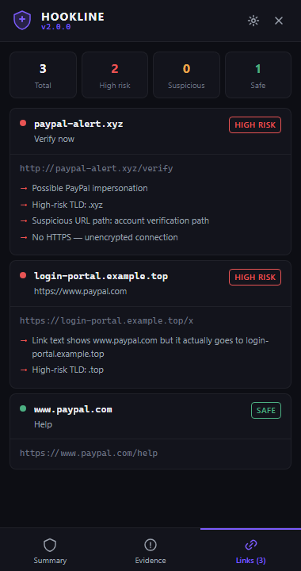

# Hookline

A Chrome extension that spots phishing, fake job offers and fake online stores, in Gmail and on web pages, and tells you **why** something looks risky.

Each result gets a verdict (safe / suspicious / high risk), a scam type (credential phishing, job/internship scam or shopping scam), the reasons behind it, and what to do next.

<p>



</p>

## What it looks for

- **Phishing:** look-alike domains (`paypa1.com`, Cyrillic letters), brand names on unofficial sites, fake login pages, link text that hides the real address, mismatched Reply-To.
- **Job scams:** upfront fees, fake-check schemes, recruiters on Gmail claiming to be a company, moving you to WhatsApp or Telegram, offers made without an interview, "$45/hr, no experience" pay, early requests for SSN or bank details.
- **Shopping scams:** 70–90% discounts, payment only by crypto, gift card or Zelle, no contact details, brand names in shop domains, countdown pressure.

The full rule list is in [`docs/RULES.md`](docs/RULES.md).

## Setup

**Extension**
```bash
cd extension
npm install
npm run build
```
Load `extension/dist` via `chrome://extensions` → Developer mode → Load unpacked (Chrome 116+).

**Backend (optional: adds domain age and DNS checks)**
```bash
cd backend
pip install -r requirements.txt
uvicorn main:app --host 127.0.0.1 --port 8000
```
Without it, the extension still works using its built-in checks.

**Tests:** `npm test` in `extension/`, `pytest` in `backend/`.

## Privacy

- Email and page content is analyzed in your browser and never sent anywhere.
- Only domain names go to the optional local backend.
- Google Safe Browsing and URLhaus lookups are off by default and can be turned on in Settings.

## Results

Tested once on held-out halves of public datasets (25,000 URLs per class):

- Phishing URLs: 24–26% detected, 0.2–0.5% false alarms, 98–99% precision.
- Fake job ads (EMSCAD): 6.2% detected, 0.1% false alarms. Most job-scam
  rules target what happens in conversation, not in the ad.
- Shopping scams: no labelled dataset exists, so only unit-tested.

An earlier version reported 40.5% recall. That figure came from an
evaluation bug (a "no HTTPS" rule fired on every row). Measured correctly
it was 11.7%. Details in `extension/eval/RESULTS.md`.

## Limitations

- Hookline misses most phishing URLs (about 75%). A "safe" verdict means
  no warning signs were found, not that a link is safe.
- Precision was measured on balanced samples and will be lower in real
  browsing, where phishing is rare.
- Rules see only the URL and text, so new domains with ordinary names
  pass unnoticed.
- Gmail extraction was tested on synthetic page markup. Gmail's layout
  can change without notice.
- Datasets are from 2012–2024. Language checks are English-only.
