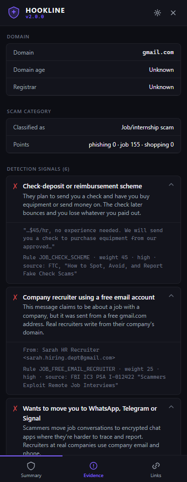
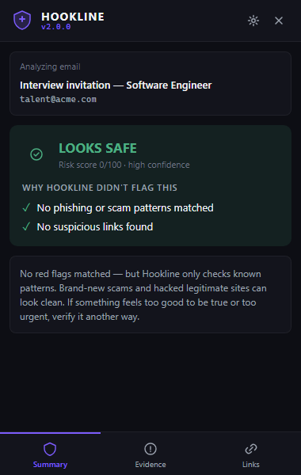
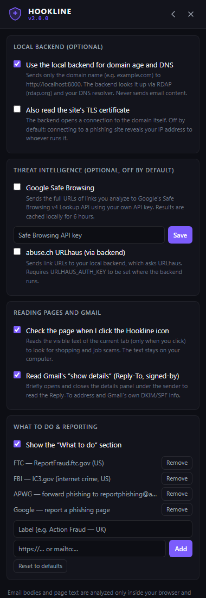

# Hookline

A Chrome extension that explains **why** an email or web page looks like a scam. It covers credential phishing, fake job and internship offers, and fake online stores. Every flag in the sidebar comes with a plain-language reason and a citable rule ID, alongside the score.

> **Research artifact.** Hookline accompanies the paper *"Too Good to Be True, Too Fast to Be Real: Why We Still Click."* It is a heuristic, explainable detector. It **will miss** real scams (see [Limitations](#limitations)) and is not a substitute for security tooling or your own judgment.

---

## What it detects

Every rule has an ID, weight, category and description in [`docs/RULES.md`](docs/RULES.md), which is generated from the code.

**Credential phishing (URLs, links in email, web pages)**
- Brand names inside non-official domains (`paypal-login.example`), matched per hostname token, so `pineapple.com` is not "Apple"
- Typosquats: leetspeak (`paypa1`), keyboard slips, 1–2 character edits, with length guards so `hive.com` is not "live.com"
- Homoglyphs: mixed scripts and look-alike characters, decoded from punycode first
- IP-address hosts, deep subdomain chains, very long or hyphen-heavy hostnames, abused TLDs, `/login` and `/verify` paths on unknown domains
- Redirect wrappers (`google.com/url?q=…`, Facebook `l.php`, Outlook SafeLinks), which are unwrapped so the real destination is analyzed
- In email: a sender name that claims a brand the domain doesn't own, Reply-To on another domain or on free webmail, urgency and credential-request language, and link text that shows one address while the link goes to another

**Job and internship scams (Gmail, job pages)**
- Upfront fees (training, equipment, registration, visa), and fake-check or "buy from our vendor" schemes
- A recruiter writing from Gmail/Outlook/Yahoo while claiming to represent a company
- Pressure to move to WhatsApp, Telegram or Signal, text-chat-only interviews, offers made without an interview
- "$45/hr, no experience" pay promises, early requests for SSN, bank details or ID, task or "liking" jobs that require deposits, and "reply within 24 hours" pressure

**Shopping scams (web pages, checked on demand)**
- 70–90% discounts, which count as "brand-new store" when the backend reports a domain under 6 months old
- Payment only by crypto, gift card, wire, Zelle or bank transfer
- No phone number or street address
- Brand names in an unofficial store domain, and countdown or "only 2 left" pressure

The sidebar labels each result **Credential phishing**, **Job/internship scam**, **Shopping scam** or **None detected**. It then shows a **What to do** section with practical steps and reporting links (ReportFraud.ftc.gov, IC3.gov, APWG, Google). You can edit the links in Settings.

---

## Measured performance (Hookline 2.0.0)

These are held-out **test** splits, seed 42, using the lexical/content engine only (no backend, no threat intel). Full details, ablations and caveats are in [`extension/eval/RESULTS.md`](extension/eval/RESULTS.md).

| Dataset | Recall | False-positive rate | Precision | F1 |
|---|---|---|---|---|
| Kaggle phishing-site-urls (25k + 25k) | 25.5% | 0.5% | 98.2% | 0.405 |
| PhiUSIIL, UCI #967 (25k + 25k) | 23.9% | 0.2% | 99.1% | 0.385 |
| EMSCAD job ads (451 fake / 8,494 real) | 6.2% | 0.1% | 82.4% | 0.115 |

**About the old numbers:** v1.0.0 reported 40.5% recall and 12.7% FPR. Most of that came from an evaluation artifact. The harness added `http://` to scheme-less URLs, which fired the "no HTTPS" rule on every row. Measured honestly, v1.0.0 was at about 12% recall and 2% FPR. Every change since then is logged with before/after numbers in [`extension/eval/TUNING_LOG.md`](extension/eval/TUNING_LOG.md).

The low EMSCAD recall is itself a finding. Fake job *ads* look like real ones, and the strongest tells (fees, checks, chat apps, ID requests) appear later, in the *conversation*, which is what the rules target. No shopping-scam performance is claimed, because no labelled dataset of fake-store pages was available.

---

## Screenshots

These show real output of the 2.0.0 engine on **synthetic** example inputs (no real emails), rendered at side-panel width.

<table>
<tr>
<td></td>
<td></td>
<td></td>
</tr>
<tr><td>Job-scam email: category, reasons, What to do</td><td>Evidence tab: rule IDs, weights, sources</td><td>Fake-store page</td></tr>
<tr>
<td></td>
<td></td>
<td></td>
</tr>
<tr><td>Links tab: deceptive link text</td><td>Legitimate email</td><td>Settings and privacy controls</td></tr>
</table>

---

## Setup

### Extension

```bash
cd extension
npm install
npm run build          # → extension/dist
npm test               # 96 unit tests
```

In Chrome (version 116 or later): `chrome://extensions` → enable **Developer mode** → **Load unpacked** → select `extension/dist`.

### Backend (optional: domain age, DNS, URLhaus)

```bash
cd backend
python -m venv .venv
.venv\Scripts\activate            # Windows
# source .venv/bin/activate       # macOS/Linux
pip install -r requirements-dev.txt
pytest                            # 42 offline tests
uvicorn main:app --host 127.0.0.1 --port 8000
```

Check it's running: <http://localhost:8000/health>. If the backend isn't running, the sidebar says *"Backend offline — lexical checks only"* and everything else keeps working.

Optional environment variables:
- `HOOKLINE_EXTENSION_ID=<your extension id>` (from `chrome://extensions`) pins the backend to your extension only. Without it, any `chrome-extension://` origin is accepted.
- `URLHAUS_AUTH_KEY=<key>` enables the URLhaus relay. Get a free key at <https://auth.abuse.ch/>.

### Try it manually in Chrome

1. **Gmail:** open an email, then click the Hookline icon. The sidebar analyzes the open message. Open another email in the same label or search view, and the sidebar should update; v1 missed this. If Gmail's layout can't be read, you'll see *"Couldn't read this email"* with a **Retry** button.
2. **Web page:** on any shop or job page, click the Hookline icon. With "Check the page when I click the Hookline icon" on (the default), it reads the page and checks for shopping and job-scam signals. Or use right-click → **Analyze this page with Hookline**.
3. **Link:** right-click any link → **Analyze link with Hookline**, or paste a URL into the box.
4. **Settings (gear icon):** enable Safe Browsing (Chrome will ask for permission to contact `safebrowsing.googleapis.com`), paste your API key, and edit the reporting links.

---

## Privacy: what leaves your machine

| Data | Where it goes | When |
|---|---|---|
| Email body, subject, sender, links | **Nowhere.** Analyzed inside the extension. | Always local |
| Web page text | **Nowhere.** Read only when you click the icon or the context menu, then analyzed locally. | Only on your click |
| Domain name (e.g. `example.com`) | Your local backend → **rdap.org** (registration date) and your **DNS resolver** (SPF, DMARC, MX) | Only if the backend is enabled *and* running (Settings → Local backend) |
| A TLS connection to the domain itself | The site's server. This tells its operator your IP address. | Only if "Also read the site's TLS certificate" is on (**off by default**) |
| Full link URLs | **Google Safe Browsing** (v4 Lookup API, your key) | Only if you enable it (**off by default**); results cached 6 h |
| Full link URLs | Your local backend → **abuse.ch URLhaus** | Only if you enable it **and** set `URLHAUS_AUTH_KEY` (**off by default**) |

There's no telemetry, no analytics and no remote fonts. Settings and the Safe Browsing key live in `chrome.storage.local` (not synced). Results are kept in `chrome.storage.session` per tab and cleared when the browser closes.

### Permissions, and why each is needed

| Permission | Why |
|---|---|
| `sidePanel` | The sidebar UI |
| `storage` | Settings, the per-tab result cache, and the threat-intel cache |
| `contextMenus` | "Analyze link / this page with Hookline" |
| `activeTab` + `scripting` | Read the current page **only after you click** the icon or the menu. This replaces v1's access to all sites. |
| host `https://mail.google.com/*` | The Gmail content script |
| host `http://localhost:8000/*` | Talking to the optional local backend |
| *optional* host `https://safebrowsing.googleapis.com/*` | Requested only when you turn Safe Browsing on |

Removed since v1.0.0: `tabs`, `<all_urls>`-style `http(s)://*/*` host access, and `web_accessible_resources`.

---

## Limitations

- **Heuristic and lexical.** About 75% of phishing URLs in the test sets were missed. A scam on a clean-looking new domain, with no telltale keywords, passes unless domain age or threat intel catches it.
- **The allow-list is a trade-off.** The 10,000 most-visited sites (Tranco K9YYW, minus user-content hosts and URL shorteners) don't get weak lexical flags. Phishing hosted on a popular, compromised site loses those flags too; RESULTS.md §4 quantifies this.
- **Gmail's DOM is not a public API.** Extraction uses fallback selector chains and is unit-tested against synthetic markup, but Google can change Gmail at any time. When that happens, Hookline says it couldn't read the email instead of guessing. Reading Reply-To requires briefly opening Gmail's "show details" panel (this can be turned off in Settings).
- **DKIM via DNS is best-effort.** The backend probes common selectors. Gmail's own `signed-by` and `mailed-by`, shown when visible, are more reliable.
- **English-only** language rules.
- **Datasets are old and biased** (2012–2024): see RESULTS.md §8. The numbers are within-distribution estimates, not guarantees.
- **Safe Browsing v4 Lookup API:** Google has introduced v5. Check that v4 is still available for your key.

---

## Project structure

```
hookline/
├── extension/
│   ├── src/
│   │   ├── shared/        # detection engine (pure TS, unit-tested, same code used by eval)
│   │   │   ├── ruleRegistry.ts   # every rule: id, category, weight, description, source
│   │   │   ├── riskEngine.ts     # scoring, verdict, scam-category classifier
│   │   │   ├── urlAnalyzer.ts · emailAnalyzer.ts · pageAnalyzer.ts · scamDetectors.ts
│   │   │   ├── allowlist.ts + data/allowlist.generated.ts   # Tranco K9YYW top-10k
│   │   │   └── apiClient.ts · threatIntel.ts · settings.ts
│   │   ├── content/       # Gmail extraction (fallback selectors) + on-demand page snapshot
│   │   ├── background/    # per-tab state, enrichment, badge, context menu
│   │   └── sidebar/       # React UI: Summary · Evidence · Links · Settings
│   ├── tests/             # node:test suites + SYNTHETIC fixtures
│   └── eval/              # harness, datasets.json, RESULTS.md, TUNING_LOG.md, results/
├── backend/               # FastAPI: RDAP, DNS, TLS, URLhaus relay
├── docs/RULES.md          # generated rule table for citation
├── AUDIT.md · CHANGELOG.md
```

---

## Citing the data

- Kaggle *Phishing Site URLs* (taruntiwarihp), see the Kaggle page for terms.
- A. Prasad, S. Chandra, "PhiUSIIL…", *Computers & Security* 136 (2024) 103545. UCI ML Repository #967, CC BY 4.0.
- S. Vidros et al., "Automatic Detection of Online Recruitment Frauds…", *Future Internet* 9(1):6, 2017 (EMSCAD).
- V. Le Pochat et al., "Tranco: A Research-Oriented Top Sites Ranking…", NDSS 2019. List K9YYW.

## License

MIT
